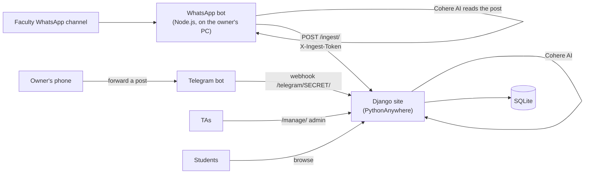

# HNU Board

**Every assignment and announcement of the Faculty of Computer Science & IT, Helwan National University, in one place.**

Live: **https://mosuatafa.pythonanywhere.com**

Students pick their level and program (no account needed) and see what's due first, then the latest announcements. TAs publish through the admin. Posts from the faculty's WhatsApp channel are imported automatically, and the owner can also forward posts from a phone through a Telegram bot.

---

## Contents

- [What it does](#what-it-does)
- [How it fits together](#how-it-fits-together)
- [Tech stack](#tech-stack)
- [Project layout](#project-layout)
- [Run it locally](#run-it-locally)
- [Configuration (`.env`)](#configuration-env)
- [Deploying to PythonAnywhere](#deploying-to-pythonanywhere)
- [The WhatsApp bot](#the-whatsapp-bot)
- [The Telegram bot](#the-telegram-bot)
- [How imported posts get their level](#how-imported-posts-get-their-level)
- [Duplicates](#duplicates)
- [Admin and TAs](#admin-and-tas)
- [Maintenance](#maintenance)
- [Troubleshooting](#troubleshooting)
- [Tests](#tests)
- [Project rules](#project-rules)

---

## What it does

**For students**
- Pick a **level** (1–4) and **program** (DS, MSE, RSE) to open a board. The choice lives in the URL (`/?year=4&program=ds`), so a board can be bookmarked and shared.
- **Due soon** first (open assignments by deadline), then **recent posts**, with tabs for All / Assignments / Announcements.
- **Retaking a course?** Open one course directly, whatever the level.
- Only courses of the **current semester** are shown.
- Links inside posts are clickable; long Arabic posts display right-to-left.
- **Add to calendar** on any assignment: downloads an `.ics` file, and the phone reminds the student 1 day and 2 hours before the deadline.
- The home page offers **"Continue to Level 4 · DS"** for the board opened last on that device.
- **Add to home screen**: the site installs like an app.
- Shared links show a **preview card** (title, deadline, logo) on WhatsApp, Telegram, etc.
- A **"What's new" bar** at the top for site news; students can close it.

**For TAs and the owner**
- TAs publish in the admin at **`/manage/`** and can only edit or delete **their own** posts.
- The **WhatsApp bot** copies new posts from the faculty channel to the site, including posts missed while it was off.
- The **Telegram bot** lets the owner forward a post from the phone (no PC needed), fix its level/course by replying, post the "What's new" bar, check status and get a database backup.

---

## How it fits together



There are three ways a post gets on the board: a TA writes it in the admin, the WhatsApp bot imports it, or the owner forwards it to the Telegram bot. Both imports use the same code (`board/ingest.py → publish()`), so they follow the same rules for levels and duplicates.

---

## Tech stack

| Part | Technology |
| --- | --- |
| Website | Python, **Django 5.2 LTS**, Django templates |
| Front end | Plain HTML and CSS, a little vanilla JavaScript (no framework) |
| Database | **SQLite** |
| Admin / TA dashboard | Django Admin at `/manage/` |
| Python packages | `Django`, `python-dotenv` (nothing else) |
| Hosting | **PythonAnywhere** free plan |
| WhatsApp bot | **Node.js 20+**, Baileys `7.0.0-rc14` (unofficial WhatsApp Web library), `pino`, `dotenv`, `qrcode-terminal` |
| AI parsing | **Cohere** API (`command-a-03-2025`, free trial key: 1,000 calls/month) |
| Telegram bot | Telegram Bot API webhook, handled by Django (standard library only) |
| Visitor stats (optional) | GoatCounter (no cookies) |

---

## Project layout

```
HNU-board/
├── config/                 Django settings, root URLs
├── board/                  the only Django app
│   ├── models.py           AcademicYear, Program, Course, Post, SiteNotice
│   ├── views.py            public board, post page, calendar (.ics) download
│   ├── admin.py            admin; TAs see only their own posts
│   ├── ingest.py           WhatsApp import (/ingest/) + shared publish/duplicate logic
│   ├── telegram.py         Telegram webhook, tags, fixes, /status, /backup, /notice
│   ├── llm.py              Cohere prompt (Python twin of whatsapp-bot/parser.js)
│   ├── context_processors.py   "What's new" bar + analytics on every page
│   ├── templatetags/       linkify filter (clickable, safe links)
│   ├── management/commands/fix_import_levels.py
│   ├── fixtures/hnu_courses.json   levels, programs, 105 courses (2022 bylaws)
│   ├── templates/board/    base, list, detail, cards
│   ├── static/board/       site.css, filter.js, notice.js, manifest, icons, logo
│   └── tests/              118 tests
├── whatsapp-bot/           Node.js bot (runs on the owner's PC)
│   ├── index.js            listens to the channel, publishes, catches up
│   ├── catchup.js          fetches the last 30 channel posts after (re)connecting
│   ├── parser.js           Cohere prompt + regex fallback
│   ├── connect.js          WhatsApp login (QR) and auto-reconnect
│   ├── find-channel.js     prints a channel's id from its invite link
│   ├── list-recent.js      lists recent channel posts (debugging)
│   ├── start-bot.bat       starts the bot and restarts it if it stops
│   └── SETUP.md            step-by-step bot setup
├── PLAN.md                 full design: scope, schema, decisions, history
├── CLAUDE.md               rules for AI assistants working on the repo
├── requirements.txt
└── .env.example
```

---

## Run it locally

Needs **Python 3.10+**.

```bash
git clone https://github.com/moustafasayed068/hnu-board.git
cd hnu-board
python -m venv .venv
source .venv/bin/activate            # Windows: .venv\Scripts\activate
pip install -r requirements.txt
cp .env.example .env                 # Windows: copy .env.example .env
```

In `.env`, set at least:

```
DJANGO_SECRET_KEY=any-long-random-text
DJANGO_DEBUG=1
DJANGO_ALLOWED_HOSTS=localhost,127.0.0.1
```

Then:

```bash
python manage.py migrate
python manage.py loaddata hnu_courses     # levels, programs and courses
python manage.py createsuperuser
python manage.py runserver
```

- Site: http://127.0.0.1:8000
- Admin: http://127.0.0.1:8000/manage/

> On Windows, if activating the venv fails with "running scripts is disabled", run once:
> `Set-ExecutionPolicy -Scope CurrentUser RemoteSigned`

---

## Configuration (`.env`)

The site reads everything from `.env` next to `manage.py`. **Never commit `.env`.**

| Variable | Needed? | What it does |
| --- | --- | --- |
| `DJANGO_SECRET_KEY` | Yes | Django secret. Generate: `python -c "import secrets; print(secrets.token_urlsafe(50))"` |
| `DJANGO_DEBUG` | Local only | `1` = debug. Leave empty in production. |
| `DJANGO_ALLOWED_HOSTS` | Yes | e.g. `mosuatafa.pythonanywhere.com` |
| `DJANGO_CURRENT_SEMESTER` | Optional | `1` or `2`. Empty = guessed from the date (Sep–Jan = 1, Feb–Aug = 2). |
| `INGEST_TOKEN` | For the WhatsApp bot | Shared secret; the same value goes in `whatsapp-bot/.env`. Empty = import off. |
| `TELEGRAM_BOT_TOKEN` | For Telegram | From @BotFather. |
| `TELEGRAM_WEBHOOK_SECRET` | For Telegram | Any random text; used in the webhook URL and header. |
| `TELEGRAM_ALLOWED_USER_IDS` | For Telegram | Telegram user IDs allowed to post, comma-separated. |
| `TELEGRAM_DEFAULT_LEVEL` | Optional | Level for forwarded posts with no level. **Leave empty** so they go to every level. |
| `COHERE_API_KEY` | For Telegram | Same key as the WhatsApp bot. Empty = simple regex parsing. |
| `GOATCOUNTER_CODE` | Optional | Your goatcounter.com site code to turn on visitor stats. |

After changing `.env` on PythonAnywhere, press **Reload** on the Web tab.

---

## Deploying to PythonAnywhere

**First time:** follow `PLAN.md` → "Part E — Deployment" (virtualenv, WSGI file, static files mapping, `.env`).

**Every update** (in a PythonAnywhere Bash console):

```bash
cd ~/hnu-board && source .venv/bin/activate
git pull
python manage.py migrate                    # always: a missing migration = Server Error (500)
python manage.py collectstatic --noinput    # always: CSS, JS and icons
```

Then press **Reload** on the Web tab.

**Free plan rules**
- The web app **stops after 1 month** unless you click **"Run until 1 month from today"** on the Web tab. PythonAnywhere emails a reminder. Data is kept if you forget.
- 1 web app, 512 MB disk, no scheduled tasks on new free accounts.
- Outbound requests are limited to an allowlist (Cohere and Telegram are on it).

---

## The WhatsApp bot

Runs on the owner's Windows PC and reads the faculty WhatsApp channel through a **spare WhatsApp number** linked as a device. Full setup: [`whatsapp-bot/SETUP.md`](whatsapp-bot/SETUP.md).

> ⚠️ Baileys is unofficial. Use a spare number, never a personal one: WhatsApp can ban it.

**Setup in short**

```powershell
cd whatsapp-bot
npm install
copy .env.example .env        # fill SITE_URL, INGEST_TOKEN, CHANNELS, COHERE_API_KEY
npm run find-channel -- "https://whatsapp.com/channel/XXXX"   # prints the channel id for CHANNELS
npm start                     # first run shows a QR: scan it from the spare phone
```

**Start automatically with Windows:** `start-bot.bat` starts the bot and restarts it if it stops. To run it at login, add a shortcut to it in the Startup folder (`Win+R` → `shell:startup`).

**How it works**
1. A new channel post arrives → the bot asks the site whether it's already there (saves an AI call).
2. Cohere turns the text into fields: kind, title, levels, programs, course, deadline, links.
3. The bot sends them to `POST /ingest/`; the site validates, repairs small mistakes and publishes.
4. **Catch-up:** after every (re)connect it fetches the **last 30** channel posts and handles the ones newer than the time saved in `state.json`. Posts missed while the PC was off are picked up when it comes back (up to 30).

**Files it keeps** (all git-ignored)

| File | What |
| --- | --- |
| `auth/` | WhatsApp login. Delete it to re-link with a new QR. |
| `state.json` | Time of the last handled post. Set the channel to `0` (bot stopped) to re-import the last 30. |
| `history.jsonl` | One line per post: sent / not relevant / no text / refused / already on site. |
| `cohere-usage.json` | Cohere calls per month (warns near 1,000). |

**Useful commands**

```powershell
npm run list-recent    # (bot stopped) recent channel posts and whether they're handled
chcp 65001             # show Arabic correctly in the terminal
```

---

## The Telegram bot

For posting **from the phone when the PC is off.** Telegram calls the site's webhook on PythonAnywhere directly.

**Use it**
1. Forward or paste a channel post to the bot.
2. It publishes and replies with what it saved and where:
   ```
   Published:
   تسليم assignment · Assignment · DSC 411 · due Thu 22 Oct 23:59
   Shown on: Level 4 DS
   Edit:
   https://mosuatafa.pythonanywhere.com/manage/board/post/57/change/
   ```
3. Wrong? **Reply to that message** with a fix:

| Reply / tag | Effect |
| --- | --- |
| `#L3` | Level 3 |
| `#L3 #L4` | Both levels (one post each) |
| `#ds` `#mse` `#rse` | Program (several = one post each) |
| `#all` | Whole level, no specific program |
| `#DSC411` | Course (code without the space); the level follows the course |
| `#assignment` / `#announcement` | Type |
| `#delete` | Remove the post |

The same tags can be added when forwarding. Tags are removed from the text before saving.

**Commands**

| Command | What |
| --- | --- |
| `/help` | All tags and commands |
| `/status` | Last import from each bot, counts this month, warning after 3 days without WhatsApp imports |
| `/notice <text>` | Show the "What's new" bar on the site; `/notice off` hides it |
| `/backup` | Sends a database backup file to the chat (contains password hashes: keep it private) |

Only accounts in `TELEGRAM_ALLOWED_USER_IDS` can use it. Anyone else gets "not allowed" with their own ID, which is how you find yours.

**One-time setup**
1. In Telegram, **@BotFather** → `/newbot` → copy the token. Never paste it anywhere public; if it leaks, `/revoke` in BotFather.
2. Fill the `TELEGRAM_*` and `COHERE_API_KEY` variables in `.env` on PythonAnywhere and press Reload.
3. Connect the webhook by opening, in a browser (TOKEN and SECRET replaced):
   ```
   https://api.telegram.org/botTOKEN/setWebhook?url=https://mosuatafa.pythonanywhere.com/telegram/SECRET/&secret_token=SECRET&allowed_updates=["message"]
   ```
   It should answer `"Webhook was set"`. Check later with `https://api.telegram.org/botTOKEN/getWebhookInfo`.
4. Message the bot, put the ID it replies with in `TELEGRAM_ALLOWED_USER_IDS`, Reload.

---

## How imported posts get their level

1. **Stated in the post** ("الفرقة الرابعة", "4th year", "الفرقة الثالثة والرابعة" → 3 and 4).
2. Otherwise, **the level of the course** the post mentions, if that course is in the current semester's course list.
3. Otherwise **every level** (e.g. "تنبيه هام لجميع الطلاب"): one copy per level, rather than guessing.

Several levels or programs → one post per level/program. A course is attached only to the copy of its own level.

**Tip:** if posts about a course keep landing on every level, that course is probably missing from the list. Add it in the admin (**Courses**) with its level and semester, and future posts will match it.

To re-check posts imported before this logic existed:

```bash
python manage.py fix_import_levels            # shows the plan, changes nothing
python manage.py fix_import_levels --apply    # applies it (one Cohere call per post)
```

---

## Duplicates

A post is never published twice, even when it arrives from both bots:

- `Post.source_id`: the message id (`<channel>:<time>`, `telegram:<chat>:<message>`), plus `:L<n>` / `:<program>` for each copy.
- `Post.text_hash`: SHA-256 of the message text with spaces, case and `*bold*`/`_italic_` marks removed. A post forwarded to Telegram and later caught up by the WhatsApp bot has the same hash, so the second one is skipped.

If the text is edited before forwarding, it counts as a new post; delete the extra one in the admin.

---

## Admin and TAs

- Admin: **`/manage/`** (not `/admin/`).
- **Superusers** see and change everything, including bot posts (`created by: whatsapp-bot`) and **Site notices**.
- **TAs** are staff users in the "Teaching assistants" group. They can add posts and edit/delete only their own. This is enforced on the server.
- Create users: Admin → Users → Add, tick **Staff status**, add to **Teaching assistants**.
- Bot posts are credited to the inactive user `whatsapp-bot`, which can't log in.

---

## Maintenance

| How often | What |
| --- | --- |
| Monthly | PythonAnywhere → Web → **"Run until 1 month from today"** |
| Weekly / monthly | Backup: `/backup` in Telegram, or `python manage.py dumpdata board auth.user auth.group --indent 2 > backup-YYYY-MM-DD.json` and download it. Never commit backups. |
| Each semester | Check `DJANGO_CURRENT_SEMESTER` and the course list in the admin |
| Now and then | `/status` in Telegram; Cohere usage at dashboard.cohere.com |

---

## Troubleshooting

| Problem | Fix |
| --- | --- |
| **Server Error (500)** on every page after an update | `python manage.py migrate`, then Reload. Still failing: Web tab → **Error log**. |
| Site looks unstyled / old after an update | `python manage.py collectstatic --noinput`, Reload, then Ctrl+F5 in the browser. |
| `npm start` → "Could not read package.json" | Run it inside `whatsapp-bot/`, not the project root. |
| Bot log: "No session found to decrypt message" | Normal right after linking; ignore unless it repeats for every message. |
| Bot log: many "Connection closed, reconnecting" (408) | Unstable internet or the PC slept; it reconnects and catches up by itself. |
| Bot: "Logged out" | Delete `whatsapp-bot/auth/`, `npm start`, scan the QR again. |
| Posts missing on the site | Check `whatsapp-bot/history.jsonl` for the reason, or forward them to the Telegram bot. |
| Arabic shows as garbage in the terminal | `chcp 65001` before `npm start`. |
| Telegram bot doesn't answer | `getWebhookInfo` → `last_error_message`. A 404 means the code isn't deployed or the secret in `.env` doesn't match the webhook URL. |
| Most posts land in one level | Remove `=N` from `CHANNELS` in `whatsapp-bot/.env` and clear `TELEGRAM_DEFAULT_LEVEL`; then `fix_import_levels`. |
| Editing `state.json` doesn't take effect | Stop the bot first; it overwrites the file while running. |

---

## Tests

```bash
python manage.py test board
```

118 tests cover the models, public views, admin permissions, both imports (duplicates, levels, tags, fixes), the Telegram commands, calendar files, link safety and the level-fix command. The Cohere and Telegram APIs are mocked, so tests need no network.

Production check (with production env vars):

```bash
python manage.py check --deploy
```

---

## Project rules

The full design and every decision are in [`PLAN.md`](PLAN.md); rules for AI assistants are in [`CLAUDE.md`](CLAUDE.md). In short:

- One Django app (`board`), Django + `python-dotenv` only, plain CSS and minimal vanilla JS, SQLite.
- Public pages are read-only. Writes go through the admin, plus two approved imports: `/ingest/` (WhatsApp, token) and `/telegram/<secret>/` (owner only).
- Permissions are enforced on the server, never by hiding buttons.
- Links are `http`/`https` only and open with `rel="noopener noreferrer"`.
- Times are Cairo time (`Africa/Cairo`, `USE_TZ = True`).
- Secrets only in `.env`. Never commit `.env`, `db.sqlite3`, backups, or the bot's `auth/`.
